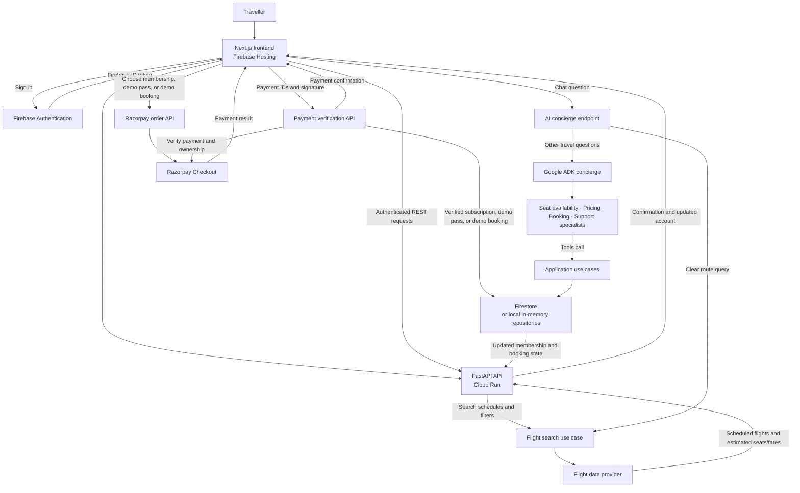
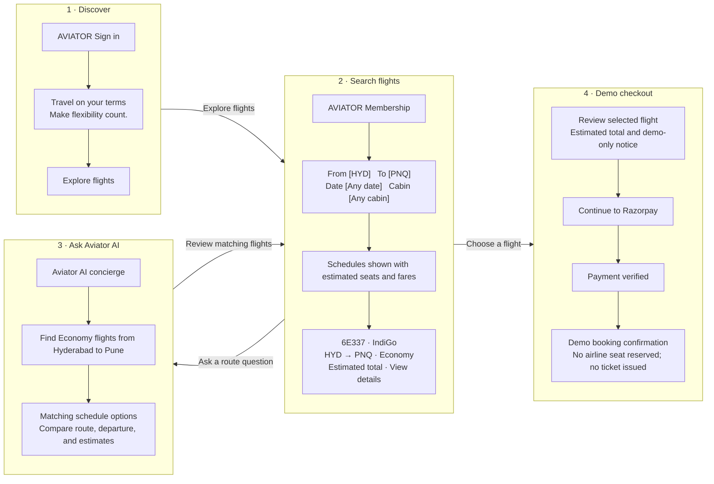

# ✈️ Aviator

A flight schedule and demo-booking experience. Flight search is free; a
one-time **₹1 Razorpay demo pass** unlocks paid demo checkout across cabin
classes. Each checkout charges the displayed estimated total; monthly
membership tiers (**Economy / Business / First**) are separate. Demo payments
do not reserve a real airline seat or issue a ticket.

Built with **Google ADK** (a 4-specialist multi-agent concierge over
Gemini), **Firebase** (Auth + Firestore + Hosting), and **Cloud Run**.

- [Architecture & SOLID design](docs/ARCHITECTURE.md)
- [Deployment guide (GCP/Firebase, from zero)](docs/DEPLOYMENT.md)

## Application flow



Flight schedules may be provided by an external schedule source, while seat
counts and fares are estimates. Demo checkout does not reserve airline
inventory or issue a ticket.

## Proposed solution wireframes

The diagrams below are conceptual screen layouts showing the main traveller
journey, not pixel-perfect designs.



## Repository layout

```
backend/    FastAPI + Google ADK agents (deploys to Cloud Run)
  app/domain/         entities, value objects, ports (interfaces)
  app/application/    use cases (business logic, framework-free)
  app/infrastructure/ Firestore/Stripe/Firebase/flight-data adapters
  app/agents/         Google ADK multi-agent system + tool functions
  app/api/            FastAPI routes + composition root (deps.py)
  tests/              unit tests against in-memory/mock adapters
frontend/   Next.js app (static export, deploys to Firebase Hosting)
infra/      firestore.rules, deploy scripts
docs/       architecture + deployment docs
```

## Quick start (zero cloud account required)

```powershell
# Backend
cd backend
py -m venv .venv
.\.venv\Scripts\pip install -r requirements.txt
copy .env.example .env   # set GOOGLE_API_KEY from aistudio.google.com (free)
.\.venv\Scripts\uvicorn app.main:app --reload --port 8080

# Frontend
cd frontend
copy .env.local.example .env.local
npm install
npm run dev
```

Visit http://localhost:3000 → **Continue as demo user** → browse flights →
chat with the concierge. Everything runs against in-memory
data and a mock payment gateway until you wire up real Firebase/Razorpay
credentials (see [docs/DEPLOYMENT.md](docs/DEPLOYMENT.md)).

## Run backend tests

```powershell
cd backend
py -m pytest tests -v
```

## Going live

See [docs/DEPLOYMENT.md](docs/DEPLOYMENT.md) for the full, from-scratch
walkthrough: creating a GCP project, enabling APIs, linking Firebase,
getting a free Gemini key, getting Stripe test keys, and deploying with
`infra/deploy-backend.ps1` (Cloud Run) and `infra/deploy-frontend.ps1`
(Firebase Hosting).
