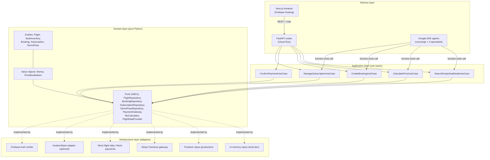

# Aviator — Architecture

Aviator provides flight schedules and paid demo checkout. Flight search is
free; a verified one-time ₹1 demo pass unlocks demo booking checkout across
cabin classes. Checkout charges the displayed estimated total but does not
reserve airline inventory or issue tickets. Monthly memberships
(Economy / Business / First) are separate.

## Layered architecture (Clean/Hexagonal)



Dependency direction always points **inward**: infrastructure depends on
domain ports, never the other way round. The application layer and domain
layer have zero imports of FastAPI, Firestore, Stripe, or ADK.

## SOLID, concretely

| Principle | Where it shows up |
|---|---|
| **S**ingle Responsibility | Each use case (`SearchEmptySeatDealsUseCase`, `CreateBookingUseCase`, ...) does exactly one job. Each ADK sub-agent owns exactly one concern (seats, pricing, booking, support). |
| **O**pen/Closed | New flight data sources (e.g. a real GDS feed) or payment gateways are added as new classes implementing `FlightDataProvider`/`PaymentGateway` — no existing code changes. Adding a 5th ADK sub-agent means adding one `Agent` to `sub_agents=[...]`. |
| **L**iskov Substitution | `InMemoryFlightRepository` and `FirestoreFlightRepository` are fully interchangeable behind `FlightRepository`; swapping them (local vs Cloud Run) requires no changes to use cases, routes, or agent tools. |
| **I**nterface Segregation | Ports are small and single-purpose (`TaxCalculator` only calculates tax; it doesn't know about bookings). Each ADK agent is given only the tool functions it needs. |
| **D**ependency Inversion | Use cases depend on abstract ports (`app/domain/ports.py`), never concrete Firestore/Stripe classes. The composition root (`app/api/deps.py`) is the only place that wires concrete adapters in. |

## Google technologies used

| Concern | Google product |
|---|---|
| Multi-agent orchestration | **Google ADK** (Agent Development Kit) — one root "concierge" agent with 4 specialist sub-agents (seat availability, pricing/tax, booking, support) |
| LLM | **Gemini** (`gemini-2.5-flash`), via a free **Google AI Studio** API key locally, or Vertex AI in production |
| Auth | **Firebase Authentication** (Google sign-in) |
| Database | **Firestore** (flights, seat inventory, bookings, subscriptions, demo passes) |
| Backend hosting | **Cloud Run** (containerised FastAPI + ADK agents) |
| Frontend hosting | **Firebase Hosting** (static Next.js export) |
| Build | **Cloud Build** (triggered implicitly by `gcloud run deploy --source`) |

`Antigravity` is Google's agentic IDE for *building* software like this
repository (similar to this conversation) rather than a runtime SDK the
product itself calls — there is nothing to "integrate" at runtime, so it is
not wired into the backend. ADK does ship an experimental
`google.adk.labs.antigravity` managed-agent integration; it is not used here
because it requires a managed agent id/preview access, but it is a
drop-in future upgrade path for the concierge agent if you have access.

## Agents

```mermaid
flowchart LR
    U[Traveller] --> R[aviator_concierge\n(root agent)]
    R --> A[seat_availability_agent]
    R --> B[pricing_tax_agent]
    R --> C[booking_agent]
    R --> D[support_agent]
    A -->|tool| T1[search_empty_seat_deals]
    B -->|tool| T2[calculate_total_price]
    C -->|tool| T3[book_empty_seat]
    C -->|tool| T4[get_booking_status]
    D -->|tool| T5[get_subscription_policy]
```

Every tool function (`app/agents/tools.py`) is a thin adapter that calls an
application-layer use case — the agents never embed business rules
themselves, so the same pricing/booking logic is used whether a traveller
goes through the REST API or the chat widget.

## Payments & tax

- Subscriptions and bookings both use **Stripe Checkout** (hosted payment
  page) rather than Stripe Elements, to keep the frontend payment surface
  minimal.
- India GST rules are modelled explicitly: **5%** on Economy, **12%** on
  Business/First, computed in `IndiaGstCalculator` and fully unit-tested.
- Money is always represented as integer minor units (paise) — never float —
  to avoid rounding bugs in financial calculations.

## Local development without any cloud account

Every external dependency has a zero-credential substitute so the full
product (seats, subscriptions, bookings, and the ADK chat concierge) can run
on a laptop with nothing but a free Google AI Studio key:

- `ENVIRONMENT=local` → in-memory repositories instead of Firestore
- `FLIGHT_DATA_PROVIDER=mock` → synthetic flights/seats instead of a real API
- No `STRIPE_SECRET_KEY` → `MockPaymentGateway` instead of real Stripe
- No Firebase project → `X-User-Id` header instead of a Firebase ID token
